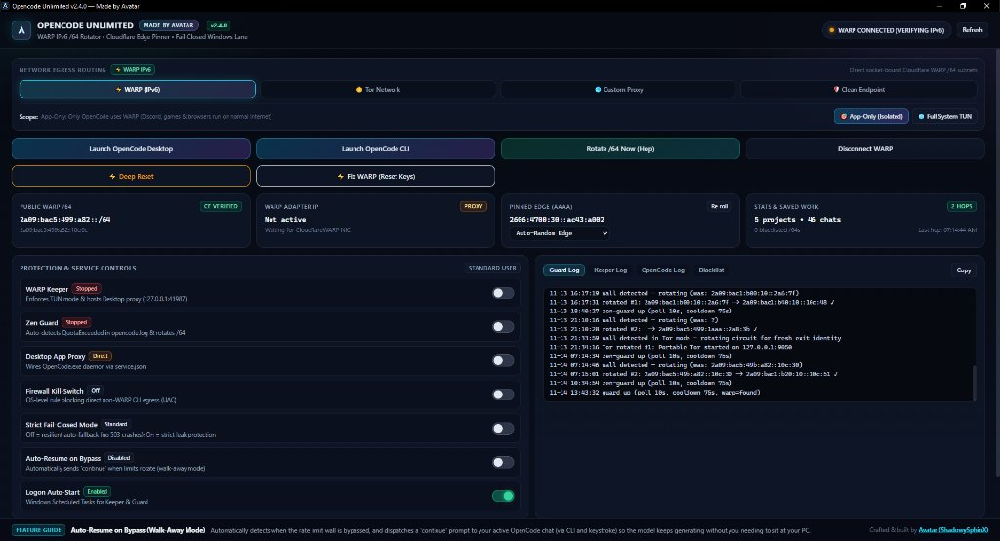

# PLEASE GIVE PROPER CREDITS. JUST DONT REBRAND AND LAUNCH IT AS YOURS.
# NEW VERSION-2.4.0 (almost all the issues are fixed)
# Opencode-Unlimited-Limit-Bypass

[](https://github.com/ShadowySphinX)
[](https://github.com/ShadowySphinX/Opencode-Unlimited-Limit-Bypass-)
[](https://opensource.org/licenses/MIT)

Automatic rate-limit rotator, multi-egress proxy router, and autonomous session auto-resume for OpenCode Desktop and OpenCode CLI.



OpenCode enforces free-tier message limits based on your inbound public IP address (`/64` prefix on IPv6, `/32` on IPv4) and Cloudflare edge connection affinity. 

This tool monitors OpenCode logs in real time, catches quota and rate-limit errors the second they appear, automatically cycles your identity (fresh IPv6 `/64`, Tor circuit, or proxy pool node), and **automatically sends "continue" to your running session** so generation continues uninterrupted.

---

## What's New in v2.4.0

* **Auto-Resume & Walk-Away Automation:** When OpenCode hits a rate limit, Zen Guard cycles your network identity and automatically sends `"continue"` to your running session (via active window keystroke injection and session database tracking). Start a complex task, walk away from your PC, and the model continues coding without pausing.
* **Zero-Click Self-Healing for Cloudflare WARP (`CF_HAPPY_EYEBALLS_MITM_FAILURE`):**
  * Auto-detects Happy Eyeballs TLS handshake failures on launch and silently repairs cryptographic keys (`tunnel rotate-keys`) in under 3 seconds.
  * Dedicated **` Fix WARP (Reset Keys)`** button on the dashboard for instant one-click key rotation.
  * Automatic protocol negotiation: switches to WireGuard for port `2408` clean endpoints and MASQUE (HTTP/3) for official Anycast.
* **Broadened Rate-Limit Detection:** Multi-pattern engine catches all variations of quota barriers (`QuotaExceeded`, `Free usage limit reached`, `rate_limit_exceeded`, `429 Too Many Requests`, `free-tier usage limit`).
* **Multi-Proxy Pool with Auto-Cycling:** Custom Proxy mode supports full proxy pools (comma, semicolon, or newline separated) with automatic round-robin cycling on rate limits and intelligent SOCKS5/HTTP fallback negotiation.
* **Isolated App-Only Mode by Default:** Only OpenCode routes through `127.0.0.1:40000`. Games, Discord, browsers, and other applications run directly on your normal internet with zero latency spikes or disconnects.
* **VPS Safe (Zero SSH Lockouts):** Isolated proxy mode strictly whitelists SSH and never hijacks default routes on cloud servers.

---

## Quick Start (Windows) — 3 Simple Steps

> You do **not** need Python installed. Everything is bundled into a single standalone program.

1. **Download & Run:**
   * Download **`OpencodeUnlimited-Multi.exe`** from the repository releases or clone.
   * Double-click to launch the dashboard.
2. **Verify Protection Controls (Left Panel):**
   * Ensure these switches are **ON** (they are on by default):
     * **WARP Keeper:** ON
     * **Zen Guard:** ON
     * **Desktop App Proxy:** ON
     * **Auto-Resume on Bypass:** ON (enables walk-away mode)
3. **Use OpenCode Normally:**
   * Open OpenCode Desktop or run `opencode` in your command prompt/terminal.
   * Work normally. When you hit a free-tier rate limit wall, the app rotates your IP and automatically resumes your session. You never have to wait for timers to reset.

---

## Restricted Countries Guide (Russia, Iran, China and others)

If your local ISP blocks or throttles Cloudflare WARP UDP traffic, choose one of these three solutions directly inside the app:

### Solution 1: Clean WireGuard Endpoints (Recommended for Low Latency)
Cloudflare's default IPs may be blocked, but dozens of Anycast edge nodes remain unblocked:
1. Open the dashboard and click the **Clean Endpoint** tab at the top.
2. Click **Ping Test**. The app benchmarks 27 unblocked endpoints in under a second.
3. Select the lowest-latency endpoint (e.g. `162.159.192.1:2408` or EU alternate `188.114.96.1:2408`).
4. Click **Apply Endpoint**. The app automatically switches protocol to WireGuard and locks onto that IP.

### Solution 2: Tor Network (Zero-Configuration Bypass)
If UDP and WireGuard are entirely blocked by your ISP:
1. Click the **Tor Network** tab at the top.
2. Click **Start Tor Daemon**.
3. The app automatically launches an isolated portable Tor SOCKS5 daemon (`127.0.0.1:9050`).
4. On rate limits, a `SIGNAL NEWNYM` command is sent to port `9051`, rotating to a fresh global IPv4 exit node in under 1 second. No Cloudflare WARP required.

---

## Tor Network Guide

If Cloudflare WARP is blocked in your region, or if you want decentralized IP rotation without Cloudflare:

### 1. Built-in Portable Tor
* Navigate to the **Tor Network** tab on the dashboard.
* Click **Start Tor Daemon**.
* The app runs a sandboxed Tor instance listening on `127.0.0.1:9050` with control port `9051`.
* It requires zero external tools or manual setup.

### 2. Using Existing Tor / Tor Browser
* If you have **Tor Browser** running, the app automatically detects its standard SOCKS port (`9150`).
* If you run a system Tor service on Linux (`systemctl start tor`), the app hooks directly into `127.0.0.1:9050`.

### 3. How Limit Bypass Works on Tor
* When OpenCode triggers a usage limit or 429 error, Zen Guard sends a `SIGNAL NEWNYM` command to Tor control port `9051`.
* Tor immediately rebuilds its 3-hop circuit and switches to a fresh exit relay IP in under a second.
* Auto-Resume fires right after, sending `continue` to your chat so your generation continues without human intervention.

### Solution 3: Custom Proxy Pool (Clash / V2Ray / Xray / sing-box)
If you already run a local proxy client:
1. Click the **Custom Proxy** tab at the top.
2. Paste your local proxy address (e.g. `127.0.0.1:7890` or `127.0.0.1:10808`).
3. Select the protocol (**SOCKS5** or **HTTP**).
4. Click **Apply & Route**.
5. *Tip:* You can paste multiple proxies separated by newlines. The app will automatically cycle through your list round-robin every time a limit is reached.

---

## How Routing Works Under the Hood

```
[ OpenCode Desktop / CLI ]
            │
            ▼ (HTTP / HTTPS via service.json)
   [ 127.0.0.1:41987 (Zen Proxy) ]
            │
   ─────────┴───────────────────────────────────────────────────────
   │ Active Egress Mode Selection                                  │
   ─────────────────────────────────────────────────────────────────
   ├── [1] WARP (Isolated Mode)    ──> 127.0.0.1:40000 (SOCKS5)    ──> Cloudflare Edge [Fresh /64 IPv6]
   ├── [2] WARP (Full TUN Mode)    ──> Virtual Adapter (Wintun)    ──> System-wide Cloudflare VPN
   ├── [3] Tor Network             ──> 127.0.0.1:9050 / 9150       ──> Tor 3-Hop Circuit [Fresh IPv4]
   ├── [4] Custom Proxy Pool       ──> Node #1 -> Node #2 -> ...   ──> Round-Robin Upstream Nodes
   └── [5] Clean Endpoint          ──> Clean WireGuard IP:2408     ──> Unblocked Edge [Fresh /64 IPv6]
```

* **Zen Guard:** Monitors `~/.local/share/opencode/log/opencode.log`. When rate limit text appears, it blacklists the exhausted IP, rotates your identity, and triggers Auto-Resume.
* **WARP Keeper:** Maintains the proxy service listener on port `41987`, health-checks tunnels, and auto-repairs dropped connections.
* **Auto-Resume:** Looks up the active OpenCode session ID in `opencode.db` and sends `continue` to the active session window.

---

## Limit Reset Comparison Table

| Method | Public Identifier | Reset Mechanism | Duration | Best For |
| :--- | :--- | :--- | :---: | :--- |
| **WARP (Isolated)** | Cloudflare IPv6 `/64` | Rotates SOCKS5 client on port 40000; assigns new `/64` prefix. Zero impact on other apps. | ~10–12s | Standard users worldwide |
| **Clean Endpoint** | Clean WireGuard IP + `/64` | Binds to unblocked WireGuard node; assigns fresh `/64`. | ~10–12s | Users in Russia, Iran, China |
| **Tor Network** | Tor Exit Node IPv4 | Sends `SIGNAL NEWNYM` to control port; builds fresh 3-hop circuit. | < 1s | Restricted networks & censorship bypass |
| **Custom Proxy Pool** | Proxy Server Public IP | Advances to the next proxy node in your pool round-robin. | Instant | Users with existing proxy setups (Clash/V2Ray) |
| **WARP (Full TUN)** | Cloudflare IPv6 `/64` | Re-registers client on virtual adapter; routes entire OS. | ~10–12s | Users wanting system-wide VPN |

---

## Troubleshooting & Quick Fixes

* **`Managed service port 42914 on 127.0.0.1 is already in use by another process`:**
  * **Cause:** A previous OpenCode Desktop session crashed or left an orphaned `opencode-cli.exe` daemon holding port 42914.
  * **Fix:** Launching OpenCode Desktop from the dashboard now scans and terminates any orphaned process holding port 42914 automatically. You can also click **Repair Service** on the dashboard.
* **`ERR_PROXY_TUNNEL: 502 Bad Gateway` or `503 Service Unavailable`:**
  * **Cause:** An upstream proxy or WARP connection dropped unexpectedly while handling an OpenCode request.
  * **Fix:** The local proxy includes direct dual-stack fallback. If an upstream tunnel drops, traffic falls back cleanly instead of throwing 502/503 errors in OpenCode.
* **Cloudflare WARP client says "Your Internet is unstable":**
  * **Cause:** MASQUE HTTP/3 UDP packets or default WireGuard port 2408 probes are being throttled or fragmented by your ISP.
  * **Fix:** Go to the **Clean Endpoint** tab, run a **Ping Test**, and click **Apply Endpoint** (or **Auto-Heal**). This locks WARP onto an unthrottled endpoint port (such as 500 or 4500) with stable WireGuard MTU.
* **Cloudflare WARP shows `Connection blocked: CF_HAPPY_EYEBALLS_MITM_FAILURE`:**
  * **Cause:** Stale WARP encryption keys or protocol mismatch from custom endpoints.
  * **Fix:** The app self-heals this automatically on launch. You can also click **`Fix WARP (Reset Keys)`** on the dashboard to immediately rotate encryption keys and restore healthy status.
* **`ECONNREFUSED: Unable to connect. Is the computer able to access the url?`**
  * **Cause:** OpenCode is configured to route through the local proxy (`127.0.0.1:41987`), but `OpencodeUnlimited-Multi.exe` is closed.
  * **Fix:** Keep `OpencodeUnlimited-Multi.exe` running in the background while using OpenCode.
* **`opencode-cli.exe not found`:**
  * **Cause:** OpenCode CLI is located in a custom or versioned directory.
  * **Fix:** Click **Install / Repair System** at the bottom left of the dashboard. The app automatically scans your system, locates the binary, and wires the paths.
* **Game latency or Discord voice drops during rotation:**
  * **Cause:** WARP is running in Full System TUN mode.
  * **Fix:** In the **WARP (IPv6)** tab, select **App Only (Isolated)**.
* **WARP stuck on "VERIFYING IPv6":**
  * **Cause:** System clock drift.
  * **Fix:** Go to Windows Settings $\rightarrow$ **Time & Language** $\rightarrow$ **Date & Time** $\rightarrow$ click **Sync now**.

---

## Linux Setup (Headless & VPS)

Run the automated installer from terminal:
```bash
bash install.sh
```
* Supports Debian, Ubuntu, Fedora, Arch Linux, NixOS, and openSUSE.
* Configures background services as systemd units (`opencode-unlimited-keeper` and `opencode-unlimited-guard`).
* Safe for cloud VPS: strictly whitelists SSH port 22 and uses isolated proxy mode so you never get locked out.

---

## Building from Source

```bash
git clone https://github.com/ShadowySphinX/Opencode-Unlimited-Limit-Bypass-.git
cd Opencode-Unlimited-Limit-Bypass-
pip install -r requirements.txt
```

To compile the standalone Windows executable:
```powershell
powershell -ExecutionPolicy Bypass -File .\build_multi_exe.ps1
```

---

## Author

Built and maintained by [Avatar (ShadowySphinX)](https://github.com/ShadowySphinX).

---

## License

MIT License. Copyright (c) 2026 Avatar (ShadowySphinX).
